# 15 道 C 语言考核题

郑州大学电控组招新考核（第一轮）。两批共 15 题，每题一个文件夹：`qN.c` 是源码，`qN.png` 是 VS Code 里编译运行的截图。

代码里注释写得比较啰嗦——每个符号、格式符、关键字为什么这么写都标了出来，纯属给自己复习用，不是标准答案，仅供参考。

## 目录

### 第一批（10 题）

| # | 考点 | 要点 | 源码 | 运行结果 |
|---|------|------|------|----------|
| 1 | 华氏温度 → 摄氏温度 | `double` / `scanf("%lf")` / `%.2f` | [q1.c](第1批-10题/第1题/q1.c) | [看截图](第1批-10题/第1题/q1.png) |
| 2 | 函数式宏求平方 | `#define SQUARE(x) ((x)*(x))`，每项都要括号 | [q2.c](第1批-10题/第2题/q2.c) | [看截图](第1批-10题/第2题/q2.png) |
| 3 | 三边能否构成三角形 | `if` 三个条件用 `&&` 串联 | [q3.c](第1批-10题/第3题/q3.c) | [看截图](第1批-10题/第3题/q3.png) |
| 4 | 指令码 → 动作 | `enum` 枚举，默认从 0 起、每项加一 | [q4.c](第1批-10题/第4题/q4.c) | [看截图](第1批-10题/第4题/q4.png) |
| 5 | 最大公约数 | 辗转相除，`static` 限制函数文件内可见 | [q5.c](第1批-10题/第5题/q5.c) | [看截图](第1批-10题/第5题/q5.png) |
| 6 | 十进制 → K 进制 | 递归按 `n/k` 往下拆，`'0'+d` 转字符 | [q6.c](第1批-10题/第6题/q6.c) | [看截图](第1批-10题/第6题/q6.png) |
| 7 | 统计非空白字符个数 | `fgets` 读带空格的整行，`isspace` 判断空白 | [q7.c](第1批-10题/第7题/q7.c) | [看截图](第1批-10题/第7题/q7.png) |
| 8 | 冒泡排序（降序） | 加 `cishu` 标记，本轮没交换就提前结束 | [q8.c](第1批-10题/第8题/q8.c) | [看截图](第1批-10题/第8题/q8.png) |
| 9 | 年、月 → 当月天数 | `switch` 故意不写 `break` 让 case 贯穿；闰年判断 | [q9.c](第1批-10题/第9题/q9.c) | [看截图](第1批-10题/第9题/q9.png) |
| 10 | 数组循环右移 n 位 | 先存进临时数组 `linshi[(i+n)%N]`，避免原地覆盖 | [q10.c](第1批-10题/第10题/q10.c) | [看截图](第1批-10题/第10题/q10.png) |

### 第二批（5 题）

| # | 考点 | 要点 | 源码 | 运行结果 |
|---|------|------|------|----------|
| 1 | 矩阵转置 | `int (*arr)[3]` 是「指向含 3 个 int 的数组」的行指针，不是二级指针 | [q1.c](第2批-5题/第1题/q1.c) | [看截图](第2批-5题/第1题/q1.png) |
| 2 | 位操作宏 | `SET_BIT` / `CLEAR_BIT` / `TOGGLE_BIT` / `CHECK_BIT`，参数全加括号，用 `1U` 避免左移 31 位的未定义行为 | [q2.c](第2批-5题/第2题/q2.c) | [看截图](第2批-5题/第2题/q2.png) |
| 3 | 云台指令安全判定 | `typedef struct` 存一组指令，判断 `pitch` 是否落在 `[-30, 60]`，边界值算安全 | [q3.c](第2批-5题/第3题/q3.c) | [看截图](第2批-5题/第3题/q3.png) |
| 4 | 汉诺塔 | 递归三步：n-1 个 → 辅助柱，最大盘 → 目标柱，n-1 个 → 目标柱 | [q4.c](第2批-5题/第4题/q4.c) | [看截图](第2批-5题/第4题/q4.png) |
| 5 | 多文件编译 + e^x 泰勒展开 | `e.h` 声明、`e.c` 定义、`main.c` 调用；`#include "..."` 先找当前目录 | [main.c](第2批-5题/第5题/main.c) · [e.c](第2批-5题/第5题/e.c) · [e.h](第2批-5题/第5题/e.h) | [看截图](第2批-5题/第5题/q5.png) |

## 运行结果截图

点开任意一题看代码和实际输出。同一目录下的 `qN.docx` 是当时提交的原文档，内容就是这张截图。

<details>
<summary><b>第一批 第 1 题</b>：华氏温度 → 摄氏温度</summary>

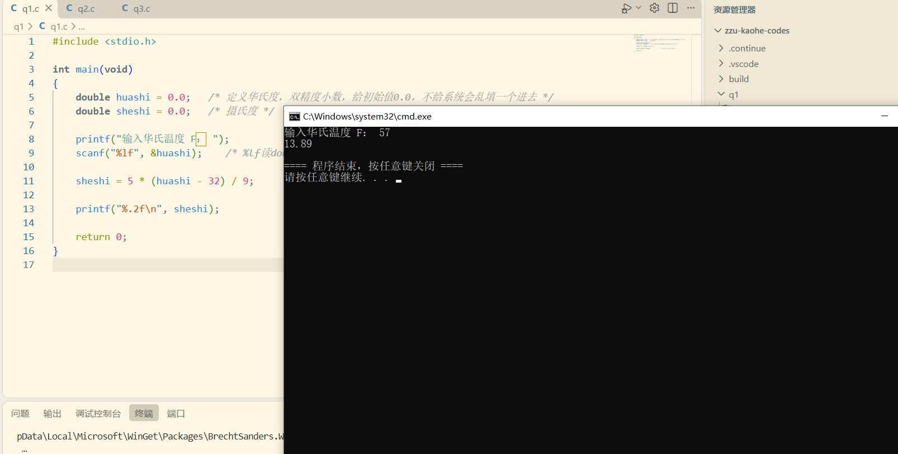

</details>

<details>
<summary><b>第一批 第 2 题</b>：函数式宏求平方</summary>

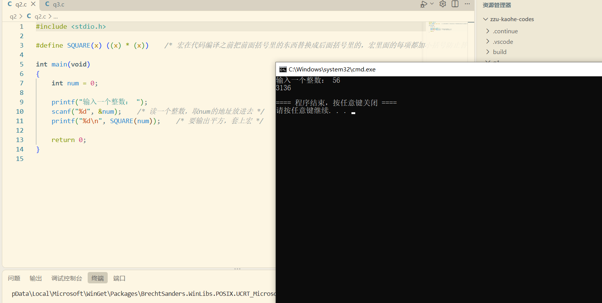

</details>

<details>
<summary><b>第一批 第 3 题</b>：三边能否构成三角形</summary>

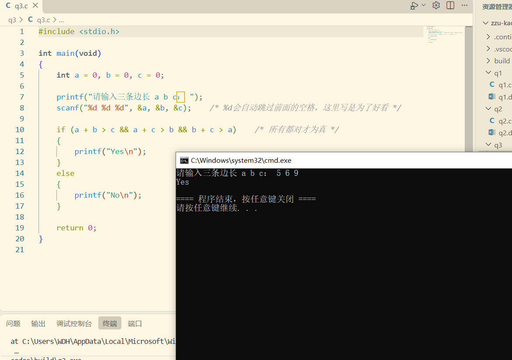

</details>

<details>
<summary><b>第一批 第 4 题</b>：指令码 → 动作</summary>

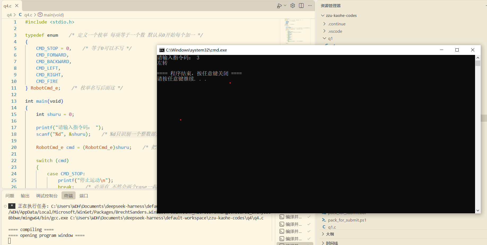

</details>

<details>
<summary><b>第一批 第 5 题</b>：最大公约数</summary>

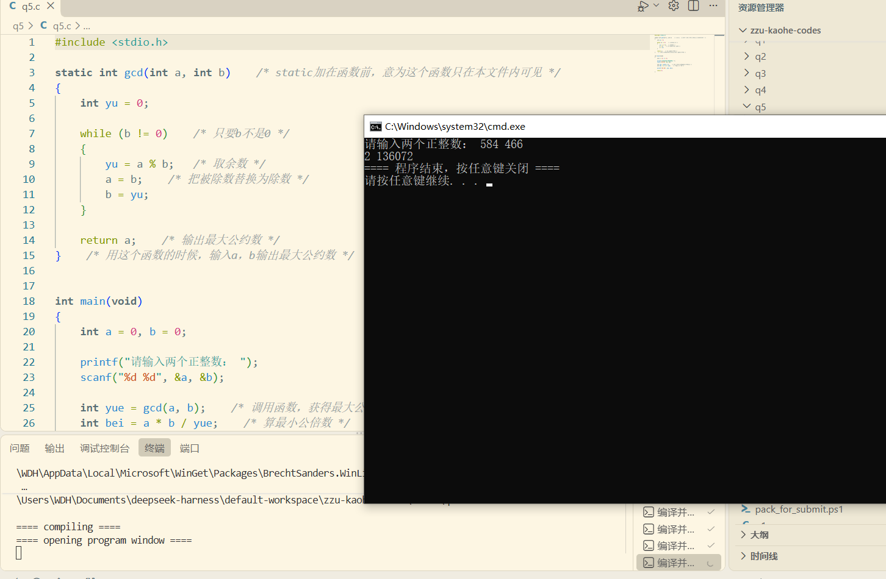

</details>

<details>
<summary><b>第一批 第 6 题</b>：十进制 → K 进制</summary>

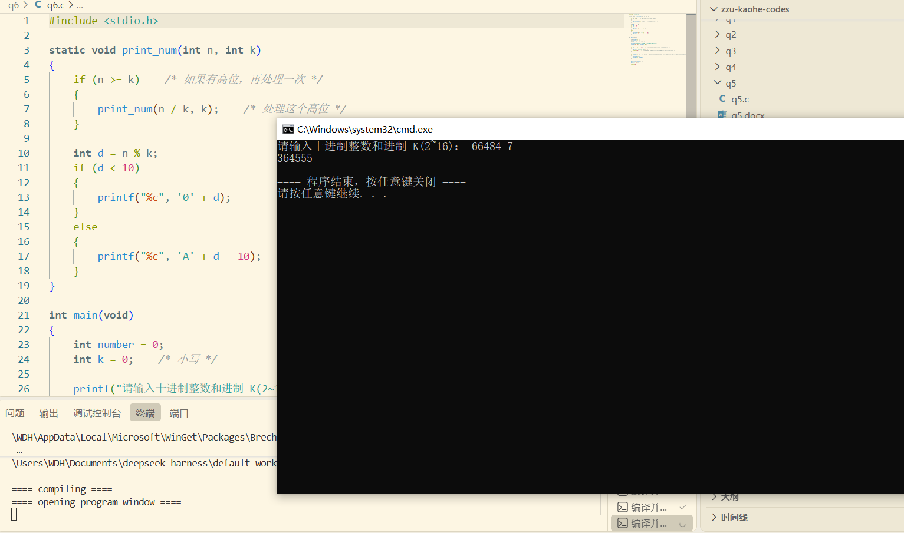

</details>

<details>
<summary><b>第一批 第 7 题</b>：统计非空白字符个数</summary>

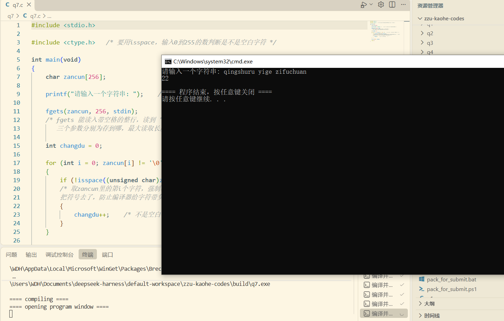

</details>

<details>
<summary><b>第一批 第 8 题</b>：冒泡排序（降序）</summary>

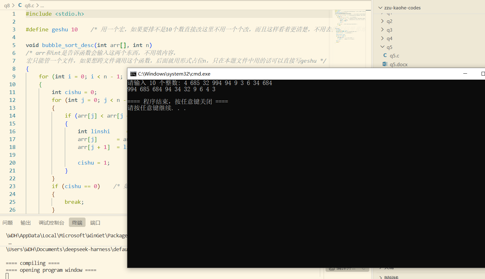

</details>

<details>
<summary><b>第一批 第 9 题</b>：年、月 → 当月天数</summary>

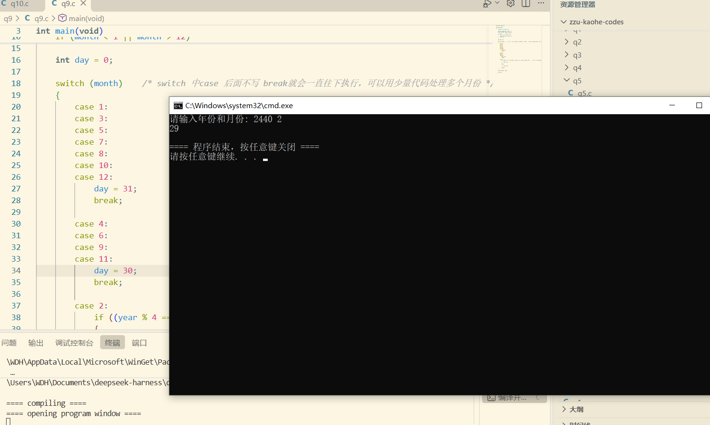

</details>

<details>
<summary><b>第一批 第 10 题</b>：数组循环右移 n 位</summary>

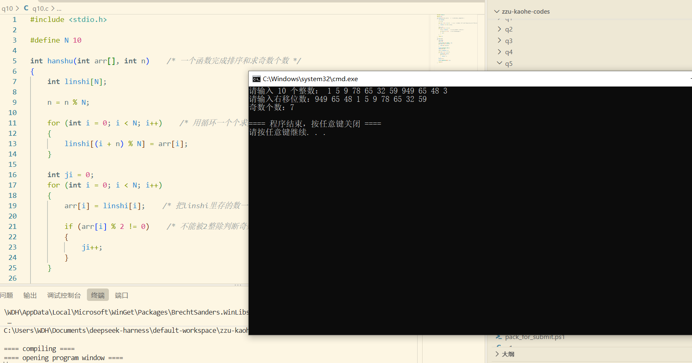

</details>

<details>
<summary><b>第二批 第 1 题</b>：矩阵转置</summary>

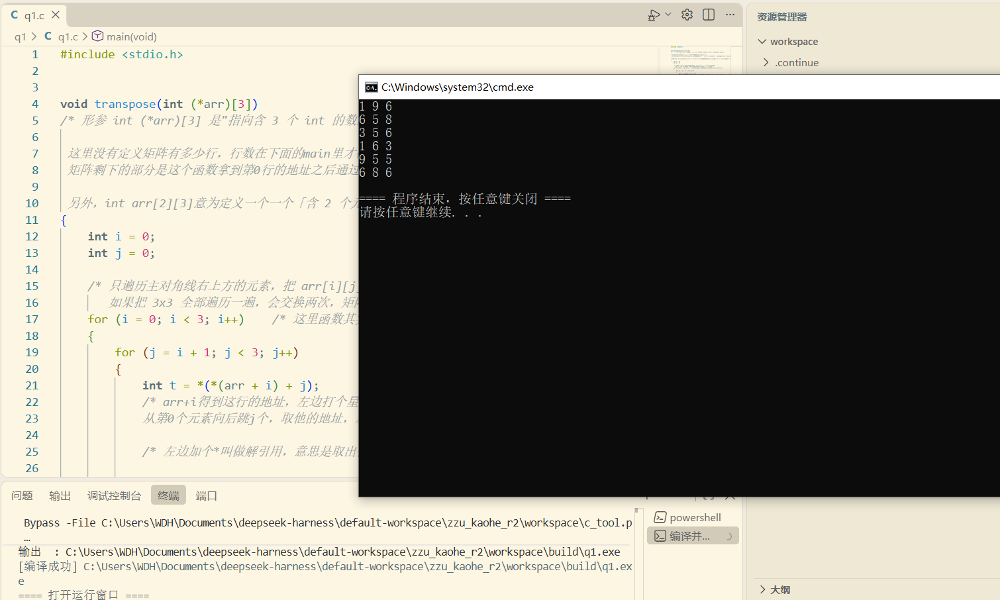

</details>

<details>
<summary><b>第二批 第 2 题</b>：位操作宏</summary>

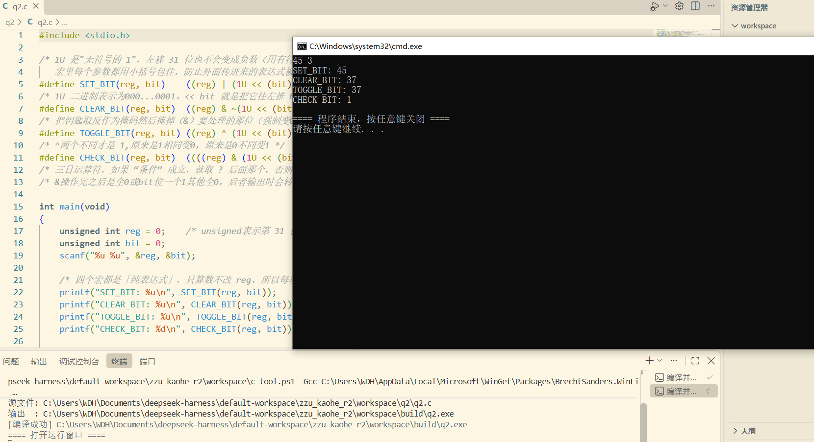

</details>

<details>
<summary><b>第二批 第 3 题</b>：云台指令安全判定</summary>

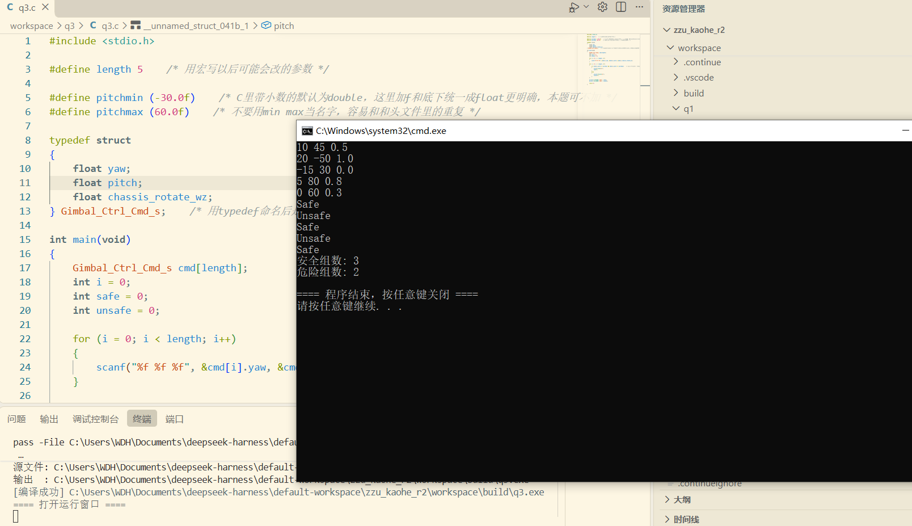

</details>

<details>
<summary><b>第二批 第 4 题</b>：汉诺塔</summary>

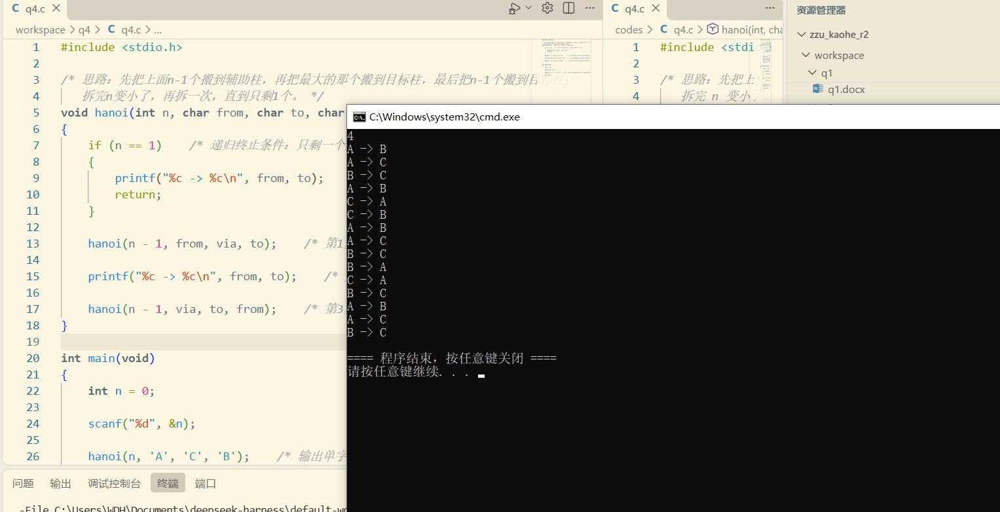

</details>

<details>
<summary><b>第二批 第 5 题</b>：多文件编译 + e^x 泰勒展开</summary>

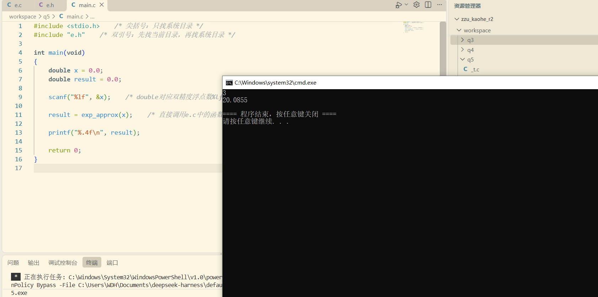

</details>

## 怎么编译运行

单文件：

```bat
gcc q1.c -o q1
q1.exe
```

第二批第 5 题是三个文件，要一起编译：

```bat
gcc main.c e.c -o e
e.exe
```

## 说明

- 代码是考核时写的解法，不保证最优，比如排序是手写冒泡而不是调 `qsort`。
- 注释里有些是当时的理解过程，回头看不一定严谨，以代码行为为准。
- 欢迎指出问题，开 issue 就行。
